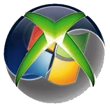

<div align="center">



# Xbox 360 WMV9 Creator

**Turn almost any video into a classic WMV9 file your Xbox 360 will play.**

Built for RGH / JTAG consoles. Drop in a file or paste a YouTube link, pick a size, click Convert.


</div>

---

## What it does

The Xbox 360 is picky about video. This app converts whatever you throw at it (MP4, MKV, AVI, MOV, FLV, WMV, YouTube links and more) into the **classic WMV9 profile**: **WMV3 video + WMA v2 audio in an ASF container**, at an exact frame size and frame rate you choose.

- **Wide input support.** Anything FFmpeg can read goes in.
- **YouTube downloads.** Paste a URL and the video is fetched with yt-dlp and queued for conversion.
- **Output presets.** Pick the size and frame rate; your choice is remembered between runs.
- **Batch queue.** Add many files and convert them in one go.
- **Output is verified.** After each conversion the file is checked (video frames present, codecs, resolution, real frame rate). Bad output is deleted instead of silently landing in your `done` folder.
- **Zero setup.** FFmpeg and yt-dlp are downloaded automatically the first time you run the app.
- **Single file.** One self-contained `.exe`. No .NET install required.

## Download and use

1. Download `Xbox 360 WMV9 Creator.exe` from the [Releases](../../releases) page.
2. Put it in a folder you can write to (for example `C:\Tools\X360WMV9\`). Avoid `C:\Program Files`.
3. Run it. On first launch a setup window downloads FFmpeg and yt-dlp (about 70 MB). This happens once.
4. Click **Select Files To Add To Queue** or **Add YouTube URL To Queue** to build your queue.
5. Choose an **Output Setting**.
6. Click **Convert Videos**. Finished files appear in the `done` folder next to the exe.
7. Copy the `.wmv` files to your Xbox 360 (USB drive or network share) and play them from the dashboard or your media app.

> **Requirements:** 64-bit Windows 10 (version 2004 / build 19041) or Windows 11, and an internet connection for the first run and for YouTube downloads.

## Output presets

| Preset | Resolution | Frame rate | Video bitrate |
|---|---|---|---|
| 1080p @ 60 fps | 1920x1080 | 60 | 12 Mbps |
| 1080p @ 30 fps | 1920x1080 | 30 | 8 Mbps |
| 720p @ 60 fps | 1280x720 | 60 | 6 Mbps |
| **720p @ 30 fps (default)** | 1280x720 | 30 | 5 Mbps |
| 480p @ 30 fps | 854x480 | 30 | 1.5 Mbps |

Audio is always **WMA v2, 48 kHz, stereo, 16-bit** (192 kbps, falling back to 128 kbps if the encoder requires it).

Videos are **letterboxed** (black bars) to the preset size, so the aspect ratio is never stretched.

**Which one should I pick?** Start with **720p @ 30**. It is the safest choice and matches WMV files known to play on the console. **1080p @ 30** is also known to work. The **60 fps** presets and **480p** are scaled from those and have **not been confirmed on real hardware yet**. If a file won't play, drop to a lower setting.

## How it works

FFmpeg can't write WMV3 (it only has the older WMV1/WMV2 encoders), and Windows' built-in H.264 decoder can silently produce an audio-only file from some sources (for example lossless x264). So the app does this for every file:

1. **FFmpeg** decodes the source and re-encodes it to a plain H.264/AAC intermediate at the exact preset size and frame rate.
2. **Windows Media Foundation** (`MediaTranscoder`) encodes that intermediate to WMV3 + WMA v2.
3. **FFmpeg** decodes the result to confirm it has real video frames, the expected codecs, the right size and the right frame rate.
4. Temporary files are removed, and the `done` folder only ever contains verified output.

## Folders created next to the exe

| Folder / file | Purpose |
|---|---|
| `done\` | Finished `.wmv` files |
| `temp\` | YouTube downloads while queued (deleted after conversion and on exit) |
| `ffmpeg.exe`, `yt-dlp.exe` | Downloaded on first run |

## Troubleshooting

**Nothing appears in `done`.** Check that the app is in a writable folder, and read the error dialog after conversion: failures are listed per file.

**The app asks to download tools every time.** It can't write next to the exe. Move it out of `Program Files` or another protected folder.

**The file converts but won't play on the Xbox 360.** Pick a lower preset (720p @ 30 is the safest) and make sure the file is playing through a player that supports WMV. Very high bitrates or frame rates can stutter on older consoles.

**"Windows' WMV9 encoder would not accept this setting."** Choose a lower preset.

**The output has no video.** The app checks for this and rejects such files. If you see the error, the source is likely unusual; try re-saving it as a standard MP4 first.

**YouTube download fails.** yt-dlp needs updates now and then as YouTube changes. Delete `yt-dlp.exe` and restart the app to fetch the latest version.

## Building from source

Requirements: Visual Studio 2022 (17.12+) with the **.NET desktop development** workload, and the **.NET 9 SDK**.

```powershell
git clone https://github.com/FreshLabs-Interactive/Xbox-360-WMV9-Creator.git
cd Xbox-360-WMV9-Creator

# Run a debug build
dotnet run -c Debug

# Produce the single-file release exe
dotnet publish -c Release
# -> bin\Release\net9.0-windows10.0.19041.0\win-x64\publish\Xbox 360 WMV9 Creator.exe
```

The project targets `net9.0-windows10.0.19041.0` (the Windows 10 target is required for the `Windows.Media.Transcoding` APIs). Release builds are self-contained, win-x64 and single-file; Debug builds are unaffected.

### Project layout

| File | Role |
|---|---|
| `MainWindow.xaml(.cs)` | Main UI, queue, YouTube download, preset selection |
| `Wmv9Converter.cs` | FFmpeg prep, Media Foundation WMV3/WMA v2 encode, output verification |
| `FfmpegArgs.cs` | FFmpeg command lines and output parsing |
| `OutputPreset.cs` | The preset table (edit this to add or tweak presets) |
| `DependencyDownloader.cs` | First-run FFmpeg and yt-dlp download |
| `SetupWindow.xaml(.cs)` | First-run progress window |
| `ConversionWindow.xaml(.cs)` | Conversion progress window |

## Credits

- [FFmpeg](https://ffmpeg.org/): video and audio decoding (the downloaded build is GPL-licensed; see FFmpeg's own license terms)
- [yt-dlp](https://github.com/yt-dlp/yt-dlp): video downloads
- Windows Media Foundation: WMV9 encoding

## Disclaimer

Only convert and download content you have the right to use. This project is not affiliated with Microsoft or Xbox. "Xbox 360" is a trademark of Microsoft.

---

Made by **FreshLabs Interactive**
